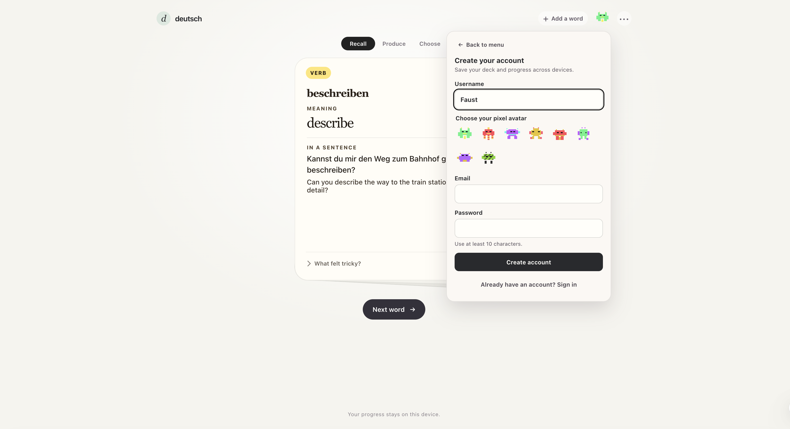

# Deutsch Daily Deck

A calm, local-first German vocabulary companion for learners using a course such as the [vhs-Lernportal](https://www.vhs-lernportal.de/). It helps organize a learner's own vocabulary notes by lesson and build **usable recall**, not just familiarity with translations. It complements course instruction; it is not an official vhs-Lernportal product or a replacement for the course.



Fresh installs include **2,593 German vocabulary cards**, organized into frequency-ranked core vocabulary and ten topical sets. The source supplies A1/A2 labels (919 A1 and 1,674 A2); these are supplemental, not vhs-Lernportal or Goethe course lists, and the labels are not independently validated. You can add your own course words or import a larger set. Studying remains local-first; optionally create an account to sync your deck and goal across devices.

On your first visit, a brief introduction explains what Deutsch Deck is and isn't; you can revisit it under **··· → About Deutsch Deck**.

## Start the app

Requirements: Node.js 22.12 or newer.

Local study works without an account server. To enable account creation and cloud sync, copy `.env.example` to `.env` and set `MONGODB_URI` to your full MongoDB Atlas connection string, including username and password, with the database path `/deutsch`. URL-encode special characters in the credentials and put query options after a single `?`. The server explicitly uses only the `deutsch` database, where it creates `users`, `progress`, and `sessions` collections. Use a rotated database user restricted to that database, not one with broad access to other databases. Set `SESSION_SECRET` to a random secret of at least 32 characters (for example, generate one with `openssl rand -base64 32`). The `.env` file is ignored by git and the MongoDB URI is only read by the server, not sent to the browser.

The development command starts both the Vite app and account API:

```sh
npm install
npm run dev
```

Open the local URL printed by Vite. For production, build the client and run the server with `NODE_ENV=production` and the same database/session environment variables:

```sh
npm run build
npm start
```

To try the production build locally, including the installable/offline app shell, use `npm run build` followed by `npm run preview`.

The production service worker needs a secure context: HTTPS when hosted, or localhost during local development. The first online visit caches the app shell; it cannot provide content that was never downloaded.

## Deploy on Render

The repository includes a Render Blueprint in `render.yaml`. Create a Render Blueprint instance from this repository and provide a full `MONGODB_URI` whose path names `/deutsch`. Use a rotated MongoDB user restricted to the `deutsch` database. Render generates `SESSION_SECRET` automatically. The service also sets `NODE_ENV=production` and trusts Render's HTTPS proxy for secure session cookies.

The Blueprint builds with `npm ci --include=dev && npm run build`, starts with `npm start`, and checks `/api/health`. Keep database credentials and secrets in Render's environment settings, never in the repository. Account creation and cloud sync require valid MongoDB settings; local study still works without them.

## License

The application code is licensed under the MIT License; see [`LICENSE`](./LICENSE). The bundled starter vocabulary data is a separate work licensed under CC BY-SA 4.0, as described above.

## How to study

On opening the app, Recall starts when locally saved reviews are due; otherwise, Learn opens if there are unseen words. If neither is available, the completion screen shows when to return. You can choose another mode at any time, and syncing or new reviews becoming due won't switch your current mode.

In **··· → Tune session**, open **View reviewed words** to search the selected set, inspect recent reviews and the next review time, or reset an individual word. You can also reset review progress for the entire selected set. After confirmation, affected words become new again and their review history, scores, and schedules are erased. Words shared with other sets are reset there too; vocabulary content remains. Download a backup first if you want to keep a copy of the old history.

### Learn unfamiliar words

Select **Learn** (or **Learn new words** when the session is complete) to explore unseen active cards before reviewing them. Open **··· → Learn settings** to choose Guided, Browse, or Continue learning and filter by topic or level. Each card shows its meaning, example, and noun details where available. The optional gentle multiple-choice check hides the word until you answer and gives feedback without scoring or scheduling. Skip excludes a word from Guided for this Learn session; Save keeps it in Continue learning, on this device and in optional account sync.

When you feel ready, choose **Ready to review**, then Recall, Choose, or Produce. The card's first review is recorded only when you submit an answer or rating, not when you open it. First reviews count toward the shared daily new-word target; if it is reached, the review chooser offers to continue beyond it for the current visit/day.

Use the copy icon beside a German word or example. In Recall, these are available after revealing the answer; in Choose and Produce, the answer can be copied after submission. Noun words include their article.

In Learn and after revealing or submitting an answer, one starter example offers a trial of word-by-word highlights: select an underlined German word to highlight its English match. Other examples remain unchanged until their matches are verified.

**Listen** is available in Learn and after an answer is revealed or submitted. It uses a human recording for a small, verified set of words (Haus, Gesundheit, Wasser, Buch, and Familie); these recordings speak the word without its article. On clicking Listen, the browser requests the recording directly from Wikimedia Commons, which can see the request. The source, author, and CC BY-SA 3.0 license are linked on each applicable card; recordings are unchanged. The app does not bundle, download for offline use, or app-cache them. For other words, or if playback fails, it uses an available German device voice. Device voice availability and connectivity requirements depend on the browser and device; if unavailable, the app says so.

### Recall

1. **Look at the prompt before revealing it.** For nouns, the article is hidden so you can retrieve it rather than merely reread it. Try to recall the plural and meaning too.
2. **Reveal the answer** to check the noun article, plural, meaning, and example sentence with translation. Verb cards show their meaning and an example.
3. If useful, open **“Missed a detail?”** and mark whether the article, plural, meaning, or example was difficult. This is optional and helps the app notice repeated patterns; it does not silently change your schedule.
4. Choose how recall felt:
   - **Again** means you could not retrieve it; the card returns in about 10 minutes.
   - **Hard** means you got it with effort.
   - **Good** means you recalled it normally.
   - **Easy** means it came quickly.

   Each rating button previews the next interval. Be honest rather than choosing a higher rating to clear cards faster.
5. Work through the due cards and the new-card allowance for your selected intensity. Due reviews come first; future cards are not brought forward just to fill the set. Your daily new-card allowance is shared across study sets and sessions.

### Produce and Choose modes

Use **Produce** to see an English meaning and type the German word or phrase from memory. Include the article for nouns. Answers ignore case, repeated spaces, and punctuation at the edges, but require the saved German spelling; unrecorded synonyms are not automatically accepted. It gives the saved form and example as feedback and keeps a separate production score. Correct typed answers are scheduled as Hard; misses are Again.

Use **Choose** to practise recognition: select the German word (including the article for nouns) from four options. It gives immediate feedback, reveals the example, and keeps a separate cumulative recognition score.

Correct choices are recorded as **Hard**, not Good: options provide cues, so a correct selection is easier than producing the answer unaided. A wrong choice is recorded as **Again** and returns sooner. Recognition, typed production, and self-rated recall remain distinguishable in saved review history; none alone proves language mastery. Distractors prefer the current study set, matching word type and level when possible. If that set is too small, the app clearly notes that some options come from other study sets; it only disables the quiz when the full deck still lacks enough distinct choices.

### Built-in starter topics

The **Open starter** study set has 2,593 deduplicated cards: frequency-ranked core vocabulary plus Health, Clothes, Food, Feelings, Family, Nature, Time and numbers, School, Travel, and Work. The core tag covers 2,171 cards; topic tags overlap it. Open **··· → Tune session** to choose a study set, view progress, adjust the goal, or narrow by source-supplied A1/A2 labels. These themes are independent vocabulary practice; they do not represent vhs-Lernportal lesson content. Add your own lesson tags to keep course-specific words separate. Fresh installs start with this pack. Existing saved decks are not replaced; use **··· → Add open starter words** to add it without losing review history. Duplicate cards are skipped.

The starter data is a filtered and reformatted subset of [slovymovy/words at the pinned source revision](https://github.com/slovymovy/words/tree/bbef653dc3737361949403c36c822cda61cff512), based on Wiktionary content processed by [Kaikki.org](https://kaikki.org/) and [Wiktextract](https://github.com/tatuylonen/wiktextract). In addition to ten topic lists, the generator considers the first 3,000 unique alphabetic terms in the source German frequency list and keeps only source-labeled A1/A2 senses with English meanings and translated examples. The upstream data is licensed **CC BY-SA 4.0**; this adapted vocabulary subset is distributed under the same license. The code and the data have separate licensing. Source attribution and the license are in [the source repository](https://github.com/slovymovy/words) and [CC BY-SA 4.0](https://creativecommons.org/licenses/by-sa/4.0/). Its labels and translations can contain errors, so check important items against your course or a trusted dictionary. For academic citation, the upstream project requests: Tatu Ylonen, “Wiktextract: Wiktionary as Machine-Readable Structured Data,” LREC 2022.

## Review scheduling (for contributors)

The rules live in [`src/scheduler.ts`](./src/scheduler.ts). The scheduler is a deterministic, SM-2-inspired heuristic: it uses the card’s previous interval, ease factor, repetition count, lapses, and the learner’s result to choose the next due time. It is not AI/ML, FSRS, or a model of measured memory strength, and its intervals have not been tuned to guarantee retention or mastery.

New cards start with interval `0`, zero repetitions and lapses, and ease `2.5`. After a response, the scheduler applies these rules (rounding interval-day calculations to the nearest whole day):

| Rating | Next interval | State change |
| --- | --- | --- |
| **Again** | 10 minutes | Reset repetitions to `0`; add a lapse and an incorrect response; reduce ease by `0.2`, with a floor of `1.3`. |
| **Hard** | `1` day on the first success; otherwise `max(1, round(previous interval × 1.2))` | Add a repetition and correct response; reduce ease by `0.1`, floor `1.3`. |
| **Good** | `1` day on the first success; otherwise `max(1, round(previous interval × previous ease))` | Add a repetition and correct response; increase ease by `0.05`, capped at `3`. |
| **Easy** | `3` days on the first success; otherwise `max(2, round(previous interval × previous ease × 1.4))` | Add a repetition and correct response; increase ease by `0.1`, capped at `3`. |

Intervals of one or more days are added using local calendar dates. Each scheduled response appends a history event with its timestamp, rating, resulting interval/ease, mode, and any optional “Missed a detail?” fields. Recall uses the learner’s rating. A correct **Choose** or **Produce** response is scheduled as **Hard**; an incorrect answer is **Again**. Those modes are recorded distinctly, and quiz correctness is stored separately from self-rated recall.

Session selection takes active cards already due first, ordered by oldest due time (then more lapses, then oldest review); it then adds unseen cards up to the session and daily limits. The new-card allowance is shared across study sets and counts each card’s first review event once on the local calendar day. The optional “continue beyond today’s target” action only bypasses the limit for the current app visit/day; it does not change a card’s schedule. “Review today’s words again” is a practice-only loop: it does not append history, affect quiz scores, or reschedule cards.

The weak-pattern notice is another deterministic heuristic, not automatic adaptation: it considers active-card review history and optional self-reported difficulty flags. A field is surfaced only after at least five observations, three flags across at least two cards, and a flag rate of 35% or more; the highest flag rate wins. It informs the learner but does not change future prompts or intervals.

## Set a goal and daily pace

Open **Goal & pace** to set your current CEFR level, target level, target date, and vocabulary intensity. Save changes with **Save goal**. The editable default is an intensive B1 goal about 90 days away; choose your actual starting level and timeline rather than treating that example as a prediction.

| Pace | New cards per day | Due reviews per set | Approximate planning time |
| --- | ---: | ---: | ---: |
| Steady | Up to 5 | Up to 30 | 15 minutes |
| Focused | Up to 10 | Up to 50 | 30 minutes |
| Intensive | Up to 15 | Up to 80 | 50 minutes |

These are adjustable daily new-card ceilings, not required quotas; reviews of cards already learned remain available, and a small deck may not have enough new cards to fill the limit. Due reviews are prioritized within each set. The goal date and CEFR levels show a broad planning estimate based on Goethe-Institut guided-course hour ranges. The ranges vary substantially and are only a rough signal; they do not account for your previous study, aptitude, or independent practice. A B1 goal includes listening, reading, speaking, and writing. Vocabulary cards support those skills but cannot replace them or promise a CEFR result. Read the [Goethe-Institut's course-hour guidance](https://www.goethe.de/ins/gb/en/sta/lon/kur/faq.html).

There is no universal best number of new words per day. A practical start is **5–10 new cards daily** with honest retrieval and due reviews; for an intensive plan, try **10–15** only if you can keep up with reviews and still use the vocabulary in listening, reading, speaking, and writing. Reduce new cards if your due queue grows or recall quality drops. Research supports spaced practice for second-language learning, but study design and retention goals affect results; a card count alone is not a measure of proficiency. See the [second-language spacing meta-analysis](https://doi.org/10.1111/lang.12479).

## Add a word in the app

Select **Add a word** in the top bar. If a tag-based study set is selected, its tag is prefilled so new words stay with that lesson. Provide:

- The German word or phrase (enter a noun without its article; choose the article separately).
- The type and A1/A2 level.
- An English meaning.
- A short natural German example and its English translation.
- For nouns, the article is required; add the plural when known.
- Course and lesson tags separated by `|`, for example `vhs-Lernportal|Lektion 2|Essen`.

Prefer one clear, common meaning per card. If a word has several unrelated meanings, make separate cards with distinct examples. Keep example sentences short and grammatical. Do not label a word A1/A2 unless you have checked a reliable course or vocabulary source.

## Prepare and import a vocabulary set

Open the **··· deck menu → Get spreadsheet template** or **Get JSON template** (or download the [CSV template](./public/deck-template.csv) or [JSON template](./public/deck-template.json) directly). Add your own selected words from a vhs-Lernportal lesson, with the lesson recorded in `tags`, then choose **··· → Import vocabulary or backup**. The app does not log in to, scrape, or copy material from the vhs-Lernportal.

### Spreadsheet / CSV

The CSV header must include these columns:

| Column | Required? | What to enter |
| --- | --- | --- |
| `word` | Yes | German word without its article for nouns, or a phrase |
| `category` | Yes | `noun`, `verb`, `adjective`, `adverb`, `numeral`, or `phrase` |
| `article` | For nouns | Exactly `der`, `die`, or `das`; leave blank for other types |
| `meaning` | Yes | A concise English meaning |
| `example` | Yes | A natural German sentence |
| `plural` | No | The complete plural form, e.g. `die Wohnungen` |
| `translation` | No | English translation of the example |
| `level` | No | `A1` or `A2`; defaults to `A1` |
| `tags` | No | Optional tags separated by `|`, e.g. `vhs-Lernportal|Lektion 2|Essen` |

You may reorder columns, but keep the header names. Save/export as **CSV UTF-8**. A spreadsheet should quote cells containing commas or line breaks; standard doubled quotes inside a quoted cell are supported. Keep one vocabulary item per row.

Small example:

```csv
word,category,article,meaning,plural,example,translation,level,tags
Wohnung,noun,die,apartment,die Wohnungen,"Die Wohnung ist sehr schön.","The apartment is very beautiful.",A1,home|housing
verstehen,verb,,to understand,,"Ich verstehe das Problem nicht.","I do not understand the problem.",A2,communication
```

### JSON

The downloadable JSON template shows the complete supported shape. A simple file can look like:

```json
{
  "format": "deutsch-vocabulary",
  "version": 1,
  "cards": [
    {
      "word": "Wohnung",
      "category": "noun",
      "article": "die",
      "meaning": "apartment",
      "plural": "die Wohnungen",
      "example": "Die Wohnung ist sehr schön.",
      "translation": "The apartment is very beautiful.",
      "level": "A1",
      "tags": ["home", "housing"]
    }
  ]
}
```

Each entry needs `word`, `category`, `meaning`, and `example`; nouns also need `article`. `plural`, `translation`, `level`, and `tags` are optional. `tags` is a JSON array of strings. Put the course and lesson in separate tags (for example `["vhs-Lernportal", "Lektion 2"]`); the **Study set** selector can then practise all tagged words or one lesson at a time. JSON files may also be a bare array of these entries.

### What import does

- **Vocabulary imports start fresh:** imported words receive new review state and begin as unseen cards.
- **Backups preserve progress:** **Download backup** exports scheduler state and review history. Importing that file restores only cards not already present.
- **Import is additive:** existing cards are never overwritten. Identical words (same type, article, prompt, and meaning) and repeated IDs are skipped.
- Newly imported words appear in the next study set, not in the middle of the current one.
- An invalid file is rejected with a message; it does not replace your deck.

Use the JSON backup to move your deck manually between browser profiles or devices. If signed in, local changes are also synced to your account.

## Keep vocabulary useful

- Include the article with every noun and the plural when you can verify it.
- Use the exact German spelling, including umlauts (`ä`, `ö`, `ü`) and `ß`.
- Prefer a natural sentence over an artificial sentence built just to contain the word.
- Give a concise translation of the example, not another unrelated definition.
- Use consistent tags for course and lesson grouping (for example `vhs-Lernportal`, `Lektion 2`) plus themes such as `food` or `travel`. Open **··· → Tune session** to select a tag and limit the session; the daily new-card quota is shared across the whole deck.
- Check imported material for accuracy. The app does not independently verify translations, grammar, sources, or CEFR levels.

## Data, privacy, and recovery

- Cards, saved learning progress, schedule, and review history are stored in this browser's local storage for this app origin. When signed in, they are also synced to the configured MongoDB database.
- Clearing site data, changing browser profiles, or switching devices can remove or separate progress. Download backups regularly if the deck matters to you.
- Account data is stored in the `deutsch` MongoDB database when account sync is configured. The browser only receives an HTTP-only session cookie; the database URI remains on the server.
- Use a unique password. Email verification and password reset are not configured, so protect access to the account email and keep a local backup.
- If account sync is not configured, studying, adding cards, importing, and backups continue to work locally.
- If saved data cannot be read, the app warns and avoids overwriting it. Export/recovery tooling is intentionally kept separate from silent resets.

## Development checks

```sh
npm test
npm run lint
npm run build
```

See [AGENTS.md](./AGENTS.md) for the project's learning philosophy and implementation guidance. To refresh the bundled open starter data from its source, run `npm run data:starter-pack` (requires internet access).
